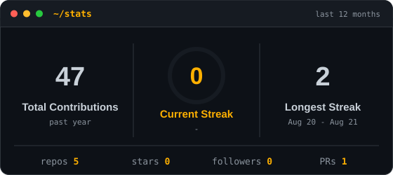
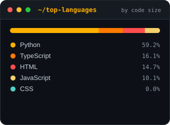

[README.md](https://github.com/user-attachments/files/34722741/README.md)
<div align="center">




<br/>


**[ projects ](#-projects)** &nbsp;·&nbsp; **[ stack ](#-stack)** &nbsp;·&nbsp; **[ quest log ](#-quest-log)** &nbsp;·&nbsp; **[ stats ](#-stats)** &nbsp;·&nbsp; **[ connect ](#-connect)**

</div>

<br/>

## 🖥️ `boot.log`

```console
[  OK  ] loading profile .................. Neelee Kumari
[  OK  ] mounting /college ................ Sri Venkateshwara College of Engineering, Bengaluru
[  OK  ] degree ........................... B.E. Computer Science Engineering (VTU)
[  OK  ] work history ..................... Software Dev Intern @ Suhitha Engineering Enterprises (GST ERP)
[  OK  ] focus areas ...................... computer-vision · ml · gen-ai/nlp · blockchain
[ RUN  ] current mission .................. satellite road extraction with deep learning
[ WAIT ] next ............................. the next ridiculous idea
```

<br/>

## 🚀 `projects`

<table>
  <tr>
    <td valign="top" width="50%">
      <h3>👁️ <a href="https://github.com/neeleekumari/visionops">VisionOps</a></h3>
      <sub><code>AI · SAFETY · SURVEILLANCE</code></sub>
      <p>Industrial AI surveillance and safety management platform.</p>
      
      
      
    </td>
    <td valign="top" width="50%">
      <h3>🗓️ <a href="https://github.com/neeleekumari/smart_sched">SmartSched</a></h3>
      <sub><code>SCHEDULING · AUTOMATION</code></sub>
      <p>Timetable generator that resolves scheduling clashes automatically.</p>
      
      
      
    </td>
  </tr>
  <tr>
    <td valign="top" width="50%">
      <h3>🛰️ RoadIntel</h3>
      <sub><code>COMPUTER VISION · SATELLITE</code></sub>
      <p>U-Net based road extraction from satellite imagery, with a Flask + React app on top.</p>
      
      
      
    </td>
    <td valign="top" width="50%">
      <h3>🪪 Visitor Pass Management System</h3>
      <sub><code>FULL-STACK · REAL-WORLD DEPLOYMENT</code></sub>
      <p>End-to-end visitor pass workflow built for a BSF camp.</p>
      
      
      
      
    </td>
  </tr>
  <tr>
    <td valign="top" width="50%">
      <h3>🚨 Emergency Humanoid System</h3>
      <sub><code>MOBILE · REALTIME</code></sub>
      <p>Mobile app for emergency response, built with React Native and Firebase.</p>
      
      
    </td>
    <td valign="top" width="50%">
      <h3>🛡️ <a href="https://github.com/neeleekumari/Surveillance">Surveillance</a></h3>
      <sub><code>PYTHON</code></sub>
      <p>Python-powered surveillance project.</p>
      
    </td>
  </tr>
</table>

<details>
<summary><b>🛰️ Peek inside RoadIntel's pipeline</b></summary>
<br/>


</details>

<br/>

## 🧰 `stack`

<div align="center">

<table>
  <tr>
    <td align="right"><b><code>languages</code></b></td>
    <td>
      
      
      
      
      
      
    </td>
  </tr>
  <tr>
    <td align="right"><b><code>frontend</code></b></td>
    <td>
      
      
      
    </td>
  </tr>
  <tr>
    <td align="right"><b><code>backend</code></b></td>
    <td>
      
      
      
      
    </td>
  </tr>
  <tr>
    <td align="right"><b><code>data</code></b></td>
    <td>
      
      
      
    </td>
  </tr>
  <tr>
    <td align="right"><b><code>tools</code></b></td>
    <td>
      
      
    </td>
  </tr>
</table>

</div>

<br/>

## 🗺️ `quest log`

```diff
+ [x] Completed a software dev internship @ Suhitha Engineering Enterprises (GST ERP)
+ [x] Built SmartSched, VisionOps, Visitor Pass Management System, Emergency Humanoid System
+ [x] Trained a U-Net to pull roads out of satellite imagery (RoadIntel)
! [~] Satellite road extraction research ........... in progress
! [~] GenAI / NLP, ML and blockchain deep-dives ..... in progress
- [ ] Next big thing ............................... loading
```

<details>
<summary><b>🕹️ Run <code>neelee --help</code></b></summary>
<br/>

```console
$ neelee --help

Usage: neelee [OPTIONS] COMMAND

Options:
  --stack    react  flask  fastapi  postgres
  --focus    computer-vision  gen-ai  ml  blockchain
  --status   learning · building · shipping

Commands:
  collab     open an issue, start a discussion, or just say hi
  coffee     optional
```

</details>

<br/>

## 📊 `stats`

<div align="center">




<br/>



</div>

<br/>

## 🐍 `contribution-snake`

<div align="center">

<picture>
  <source media="(prefers-color-scheme: dark)" srcset="https://raw.githubusercontent.com/neeleekumari/neeleekumari/output/github-snake-dark.svg"/>
  <source media="(prefers-color-scheme: light)" srcset="https://raw.githubusercontent.com/neeleekumari/neeleekumari/output/github-snake.svg"/>
  
</picture>

</div>

<br/>

## 📫 `connect`

<div align="center">

[](https://github.com/neeleekumari)
<!-- [](https://linkedin.com/in/YOUR-HANDLE) -->
<!-- [](mailto:YOUR-EMAIL) -->

```console
$ exit 0
Thanks for stopping by. If something here is useful, a ⭐ is always appreciated.
```

</div>
