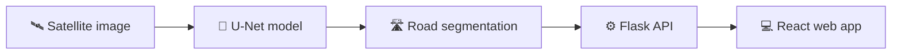

 

 

[**Projects**](#-featured-projects) · [**Tech**](#-tech-arsenal) · [**Stats**](#-github-stats) · [**Connect**](#-lets-connect)

---

## 👋 About Me

I'm a Computer Science Engineering student at **Sri Venkateshwara College of Engineering, Bengaluru** (VTU). I like building software that actually gets used: ERP systems, AI dashboards, and deep learning that reads satellite images.

| | |
|---|---|
| 🎓 **Studying** | B.E. Computer Science Engineering (VTU) |
| 💼 **Experience** | Software Development Intern, Suhitha Engineering Enterprises (GST ERP) |
| 🔭 **Exploring** | Satellite road extraction with deep learning |
| 🧠 **Interested in** | Computer Vision · ML · Generative AI / NLP · Blockchain |
| 🛠️ **Day-to-day stack** | React · Flask · FastAPI · PostgreSQL |

---

## ⚡ Featured Projects

<table>
  <tr>
    <td valign="top" width="50%">
      <h3>👁️ <a href="https://github.com/neeleekumari/visionops">VisionOps</a></h3>
      Industrial AI surveillance and safety management platform.
        
      
      
      
    </td>
    <td valign="top" width="50%">
      <h3>🗓️ <a href="https://github.com/neeleekumari/smart_sched">SmartSched</a></h3>
      Timetable generator that resolves scheduling clashes automatically.
        
      
      
      
    </td>
  </tr>
  <tr>
    <td valign="top" width="50%">
      <h3>🛰️ RoadIntel</h3>
      U-Net based road extraction from satellite imagery with a Flask + React app on top.
        
      
      
      
    </td>
    <td valign="top" width="50%">
      <h3>🪪 Visitor Pass Management System</h3>
      End-to-end visitor pass workflow built for a BSF camp.
        
      
      
      
      
    </td>
  </tr>
</table>

<b>🛰️ How RoadIntel works (click to expand)</b>

---

## 🧰 Tech Arsenal

---

## 📊 GitHub Stats

 

---

## 🐍 Contribution Snake

---

## 🎯 Currently

- 🔭 Building **satellite road extraction** with deep learning
- 🌱 Going deeper into **GenAI / NLP**, **ML** and **blockchain**
- 🛠️ Polishing **VisionOps** and my other repos
- 💬 Ask me about: React, Flask / FastAPI, PostgreSQL, computer vision

---

## 📫 Let's Connect

<!--  -->
<!--  -->

⭐ If you like something here, a star on the repo is always appreciated.

